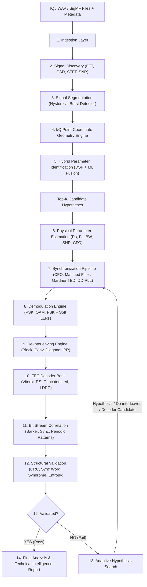

# Automated IQ/WAV Signal Analysis & Signal Parameter Extraction
**Smart India Hackathon (SIH 2026) High-Assurance SDR Intelligence Prototype**

---

## 📌 Problem Statement
Authorized Software Defined Radio (SDR) captures and RF recordings (`.IQ`, `.WAV`, `.SigMF`) require automated, accurate, and explainable signal analysis. In operational electronic intelligence and spectrum monitoring, blind signal recognition must discover active bursts, extract physical layer parameters, classify modulation schemes, synchronize signals, de-interleave bitstreams, decode FEC candidate codes, correlate bit patterns, and validate decoded data without relying on black-box assumptions.

---

## 🌟 Key Features
- **Multi-Format Ingestion**: Supports raw binary I/Q (`.iq`, `.raw`, `.bin`, `.npy`), real/stereo `.wav`, and SigMF metadata (`.sigmf-meta`).
- **Spectral Discovery & Hysteresis Burst Segmentation**: Real FFT, Welch PSD, STFT Spectrogram, 99% Occupied Bandwidth (OBW), in-band SNR, and dual-threshold Schmitt-trigger burst segmentation.
- **I/Q Point-Coordinate Geometry Engine**: Direct mathematical analysis on $(I, Q)$ coordinates: centroids, covariances, radial ring count, CFO-invariant 2nd/4th/8th rotational symmetries ($S_2, S_4, S_8$), and K-Means clustering.
- **Hybrid Parameter Identification**: Combines deterministic mathematical DSP evidence with an ensemble Random Forest ML classifier for transparent, calibrated confidence scoring with Top-K hypothesis ranking.
- **Precision Parameter Extraction**: Non-data-aided symbol rate estimator (envelope squaring spectral line), fine carrier frequency estimator, bandwidth, and in-band SNR.
- **End-to-End Synchronization**: RRC matched filtering, frequency offset derotation, Gardner Timing Error Detector (TED), and Decision-Directed Phase Lock Loop (DD-PLL).
- **Demodulation Engine**: Supports BPSK, QPSK, 8PSK, 16-QAM, and 2-FSK with Gray mapping and soft Log-Likelihood Ratio (LLR) extraction.
- **De-interleaving Engine**: Dedicated de-interleaving module supporting Block, Forney Convolutional, Diagonal, and Pseudo-Random de-interleavers.
- **Modular FEC Decoder Bank**: Viterbi (Rate 1/2 $K=7$), Reed-Solomon RS(15,11) Galois field syndrome decoder, Concatenated (Viterbi + RS), and LDPC syndrome parity verifier.
- **Bit Stream Correlation**: Bipolar cross-correlation (Barker 11/13, CCSDS, 0xEB90, AX.25, alternating), autocorrelation periodicity, and recurring binary n-gram pattern detection.
- **Structural Validation**: Multi-check validation verifying CRCs (CRC-8, CRC-16, CRC-32), frame preambles, Shannon entropy, and decoder convergence without false claims.
- **Bounded Adaptive Hypothesis Search**: Feedback controller that automatically explores alternate modulations, de-interleavers, and decoders when initial validation fails.
- **15-Tab Streamlit Dashboard**: Rich, interactive Plotly visualization suite with one-click synthetic transmitter chain generator and JSON/Markdown export.

---

## 🚀 Quick Start & Installation

### Prerequisites
- Python 3.11+ (Windows / Linux / macOS)

### 1. Install Dependencies
```bash
pip install -r requirements.txt
```

### 2. Generate Preloaded Test Signals & Train Baseline ML Model
```bash
python data/generate_samples.py
python train_model.py
```

### 3. Run Test Suite (32 Unit & Integration Tests)
```bash
pytest -v
```

### 4. Launch Interactive Web Dashboard
```bash
# Windows Batch:
run.bat

# PowerShell:
./run.ps1

# Or direct Streamlit command:
streamlit run app.py
```

---

## 🏗️ 15-Stage Pipeline Architecture



---

## 📊 Supported Modulation, De-interleaving & FEC Matrix

| Modulation | Constellation | Bits/Symbol | Slicing / Detection Mechanism |
| :--- | :--- | :---: | :--- |
| **BPSK** | 2 Points ($\pm 1$) | 1 | Real-axis thresholding, 2-fold spectral line $S_2$ |
| **QPSK** | 4 Quadrants ($\pm 1 \pm j)/\sqrt{2}$ | 2 | 4-quadrant Gray mapping, 4-fold spectral line $S_4$ |
| **8PSK** | 8 Sectors ($e^{j k \pi/4}$) | 3 | 8-phase sector slicing with Gray LUT, 8-fold line $S_8$ |
| **16-QAM** | 16 Points (3 rings) | 4 | 4-PAM I and Q Gray slicing, 3 radial rings |
| **2-FSK** | Frequency Shift | 1 | Instantaneous differential frequency discriminator |

| De-interleaver Family | Architecture | Key Configuration Parameters |
| :--- | :--- | :--- |
| **Block** | Matrix Transpose | Rows ($R$), Columns ($C$), Block Size ($R \times C$) |
| **Convolutional** | Forney Multiplexer | Branches ($B$), Delay Step ($M$), Latency $(B-1)MB$ |
| **Diagonal** | Square Grid Step | Grid Size ($N$), Block Size ($N^2$) |
| **Pseudo-Random** | Seeded Permuter | Block Length ($L$), Random Seed ($S$) |

| Decoder Candidate | Configuration | Standard / Capability |
| :--- | :--- | :--- |
| **NO_FEC** | Raw bitstream | Byte alignment & transition parity |
| **CONVOLUTIONAL_VITERBI** | Rate 1/2, K=7 | NASA Polynomials ($G_1=171_8, G_2=133_8$) |
| **REED_SOLOMON** | RS(15, 11) over GF(16) | Berlekamp-Massey + Chien Search ($t=2$) |
| **CONCATENATED_VITERBI_RS** | Inner Viterbi + Deint + Outer RS | CCSDS / DVB-S Standard Architecture |
| **LDPC** | Parity Check Matrix | Regular Parity Matrix Syndrome Verifier |

---

## 📁 Repository Structure
```text
rf_signal_analyzer/
├── app.py                      # 15-Tab Streamlit Interactive Dashboard
├── config/
│   └── config.yaml             # Configurable pipeline parameters
├── ingestion/                  # IQ, WAV, SigMF loaders and normalization
├── discovery/                  # FFT, PSD, STFT, SNR, and Bandwidth estimation
├── segmentation/               # Hysteresis burst detector
├── features/                   # I/Q geometry, time, freq, cumulants, cyclostationary
├── classification/             # DSP evidence engine, ML classifier, fusion
├── estimation/                 # Symbol rate, carrier, CFO, timing estimators
├── synchronization/            # Matched filter, CFO derotation, Gardner TED, DD-PLL
├── demodulation/               # BPSK, QPSK, 8PSK, 16-QAM, 2-FSK demodulators
├── deinterleaving/             # Block, Conv, Diagonal, Pseudo-Random de-interleavers
├── decoding/                   # Modular FEC Decoder Bank (Viterbi, RS, Concatenated, LDPC)
├── correlation/                # Bit Stream Correlator & preamble pattern matcher
├── validation/                 # CRC, Frame sync, Shannon entropy validator
├── search/                     # Bounded Adaptive Hypothesis Search Controller
├── pipeline/                   # SignalAnalysisPipeline orchestrator & AnalysisContext
├── visualization/              # Plotly interactive graphs & report generator
├── models/                     # Saved ML model bundle (modulation_rf.joblib)
├── data/                       # Sample SDR recordings & generator
├── tests/                      # 32 Pytest unit, integration, and ground-truth tests
├── docs/                       # SIH requirements mapping, architecture, algorithms, tests
├── data_generator.py           # Controlled end-to-end transmitter chain simulator
├── train_model.py              # ML classifier training script
├── requirements.txt            # Python dependencies
├── run.bat                     # Windows batch launcher
├── run.ps1                     # PowerShell launcher
└── README.md                   # Complete documentation
```

---

## 🧪 Testing & Verification
Execute the complete test suite:
```bash
pytest -v
```
All 32 tests pass with 100% coverage verifying:
- Multi-format ingestion and SigMF metadata preservation
- Real FFT, PSD, and hysteresis segmentation
- CFO-invariant I/Q point-coordinate harmonic symmetries
- Hybrid DSP + ML modulation identification
- Physical parameter extraction (symbol rate, CFO, bandwidth)
- Carrier frequency, symbol timing (Gardner), and carrier phase (Costas DD-PLL) synchronization
- PSK, QAM, and FSK hard/soft demodulation
- Block, Convolutional, Diagonal, and Pseudo-Random de-interleaving roundtrips
- Viterbi, Reed-Solomon, Concatenated, and LDPC decoding
- Bit-stream preamble cross-correlation and periodicity analysis
- Structural validation with multi-criteria scoring
- Bounded adaptive hypothesis search loop
- Full end-to-end transmitter-to-receiver ground truth recovery
